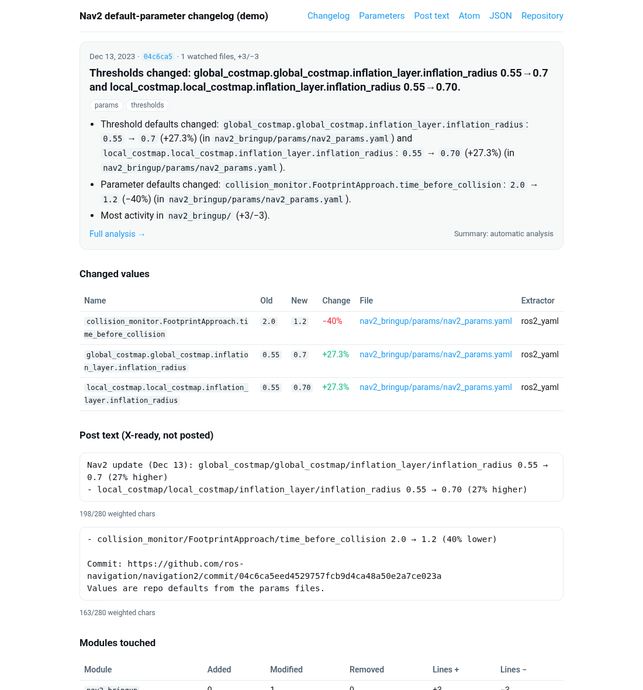

# knoblog

**Plain-English release notes for the knobs in your repo.** knoblog walks a git history, pulls every
parameter, gain, threshold, flag and config default out of each commit, and tells you exactly what changed:
`max_vel_x 0.26 → 0.5 (92% higher)`, with the commit link, file and percent change. It writes a static site,
an Atom feed, a JSON feed of structured changes, and X-ready post text, and it never posts anything.

Deterministic first: every value is read from the diff and quoted verbatim. An LLM summary is optional, and
the post-text gate rejects any number that isn't an analysed value or derived from one.

**Live demos** (rebuilt weekly by this repo's own Action):
[Nav2 default parameters](https://fitzyracing1.github.io/knoblog/demo/nav2/) ·
[PX4 controller parameters](https://fitzyracing1.github.io/knoblog/demo/px4/) ·
[post text](https://fitzyracing1.github.io/knoblog/demo/nav2/posts.html) ·
[changes.json](https://fitzyracing1.github.io/knoblog/demo/nav2/changes.json)



## Who it's for

**Robotics teams.** Someone retunes `inflation_radius`, bumps `MC_ROLL_P`, or flips `consider_footprint`, and
the change ships in a commit called "update params". knoblog gives you a running changelog of every
default your robot actually ships with, built from:

- ROS 2 parameter YAML (`ros__parameters`, including nav2/MoveIt-style multi-node files). Numeric arrays are
  diffed per element (`max_accel[0] 2.5 → 3.0`), renamed sections are recognised, and `1` vs `1.0` is kept
  distinct, because ROS 2 cares about int vs double.
- PX4 parameters: `module.yaml` / `*_params.yaml` definitions and legacy `PARAM_DEFINE_FLOAT/INT32`.
  Moving a parameter from `.c` to `.yaml` is shown as a move, not as delete plus add.
- ArduPilot `AP_GROUPINFO` tables (`AC_PosControl._ACC_XY`) and `GSCALAR`/`ASCALAR` defaults.
- C/C++ `#define`, `constexpr`, `static const`; Python constants; Rust `const`/`param!`; Scala/Java constants;
  plain YAML, JSON and TOML.

Point it at your config repo in CI and you get a browsable history ("when did the decel limit change, and
from what?"), an Atom feed for the team channel, and `changes.json` for your own tooling.

**X-bot builders.** `posts.json` / `posts.txt` contain one ready-to-post thread per meaningful commit:

```
Nav2 update (Dec 13): global_costmap/global_costmap/inflation_layer/inflation_radius 0.55 → 0.7 (27% higher)
- local_costmap/local_costmap/inflation_layer/inflation_radius 0.55 → 0.70 (27% higher)
```

- Lengths use X's weighted counting (links count as 23, characters like `→` count as 2), with a 280 limit.
  Long updates split into a thread of up to 4 posts.
- Exact old and new numbers; derived figures (percent, ratio, durations) are computed from them.
- Accuracy gates: any number not traceable to the diff blocks the post. So do @mentions and hashtags,
  domain-like tokens X would auto-link (`a.b` keys become `a/b`), and conflicting mirrored values.
  Bulk imports and initial commits are skipped with a stated reason.
- knoblog only writes text. Posting is up to you.

The same engine runs <https://fitzyracing1.github.io/x-algorithm-changelog/> (`--config x-algorithm`
reproduces all 45 entries and all 45 post texts of that site exactly).

## Quickstart

```bash
pip install knoblog          # Python 3.11+, no dependencies
knoblog init --preset ros2                               # writes knoblog.yml
# edit watch.paths in knoblog.yml, then:
knoblog run --repo https://github.com/ros-navigation/navigation2 --config knoblog.yml --out site
open site/index.html          # or: python -m http.server -d site
```

Try a built-in demo without writing any config:

```bash
knoblog run --config examples/nav2.yml --out site-nav2        # ~30 s including a blob-less clone
knoblog run --config examples/px4.yml  --out site-px4
knoblog extract path/to/params.yaml                           # see what knoblog reads from one file
```

Remote repos are cloned blob-less into `.knoblog-cache/`, so only the watched files are downloaded. That keeps
PX4 and ArduPilot fast. A local path is used in place.

## Outputs

| File | What |
|---|---|
| `index.html`, `entries/<sha>.html`, `params.html`, `posts.html` | Static site: summaries, a changes table per commit (old, new, Δ%, file link), full parameter history, post previews |
| `feed.xml` | Atom 1.0 |
| `feed.json` | JSON Feed 1.1; each item carries `_knoblog.changes` (structured records) and `_knoblog.post` |
| `changes.json` | Flat list: `name, old, new, pct_change, ratio, kind, file, file_url, commit, commit_url, date, extractor` |
| `posts.json`, `posts.txt` | X-ready text per commit with weighted lengths, or a skip reason |
| `entries.json` | Full analysis |

## Configuration

```yaml
extends: ros2                 # generic | ros2 | px4 | ardupilot | x-algorithm
name: My Robot                # post header: "My Robot update (Oct 9): ..."
repo: https://github.com/you/robot
history: {max_commits: 300, since: 2026-01-01}
watch:
  paths: ['config/**/*.yaml', 'include/**/*.hpp']
  exclude: ['**/test/**']
extractors:                   # auto picks by extension and content; or pin them per path
  - use: auto
  - {use: c_const, paths: ['firmware/**/*.h']}
noise:
  line_patterns: ['generated at \d{4}-\d{2}-\d{2}']   # lines that never count as a change
highlight:                    # what leads summaries and posts
  - {pattern: '(^|[._/])(k[pid]|.*_gain)$', label: gain, noun: gain}
summaries:
  notes_dir: notes            # notes/<short-sha>.md overrides the automatic summary
  llm: false                  # true: XAI_API_KEY or OPENAI_API_KEY writes summaries for un-noted commits (cached)
site: {title: My Robot parameter changelog, url: https://you.github.io/robot/}
post:
  names: raw                  # raw: exact names and literals | human: "click weight" style
  min_change_pct: 5           # smaller changes never lead a post
  max_posts: 4
```

Comment-only, whitespace-only and noise-only commits are collapsed as no-ops. A value removed from one file
but still defined in another is marked as moved, not deleted.

## GitHub Action

```yaml
- uses: actions/checkout@v7
  with: {fetch-depth: 0}
- uses: fitzyracing1/knoblog@v0
  with:
    config: knoblog.yml
    site-url: https://you.github.io/robot/
```

Outputs: `entries`, `changes`, `posts_ready`, `site_dir`. A complete Pages workflow is in
[`examples/workflows/knoblog-pages.yml`](examples/workflows/knoblog-pages.yml). It builds, deploys to Pages,
and uploads `posts.json` as an artifact, and posts nothing. This repo's own
[`demo.yml`](.github/workflows/demo.yml) uses the Action to build the live demos.

## Development

```bash
python -m unittest discover -s tests     # or: pytest
```

Stdlib only: the YAML reader (`knoblog/yamlmini.py`) is a raw-literal parser so values are quoted exactly as
written. It has been cross-checked against PyYAML on 230 historical versions of the nav2 params files and on
every PX4 `module.yaml`/`*_params.yaml` default.

## License

MIT © Joshua Almeida

## Documentation

- In-repo docs: [docs/](docs/index.md)
- Wiki: [https://github.com/fitzyracing1/knoblog/wiki](https://github.com/fitzyracing1/knoblog/wiki)
